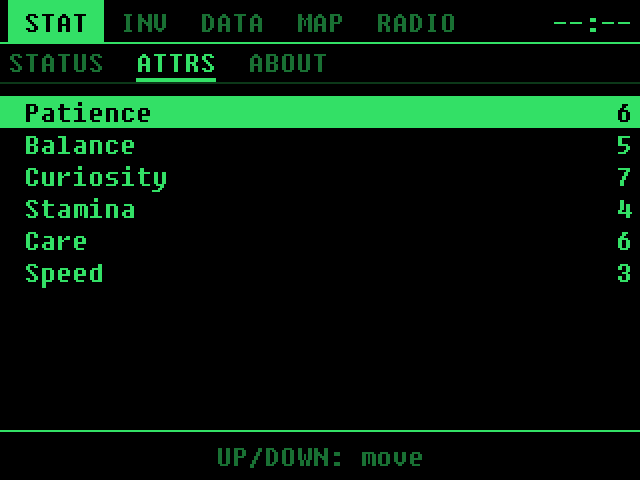
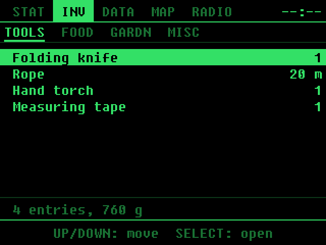
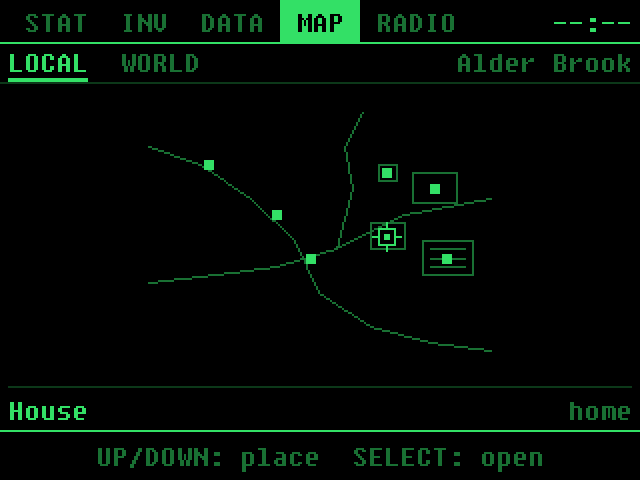
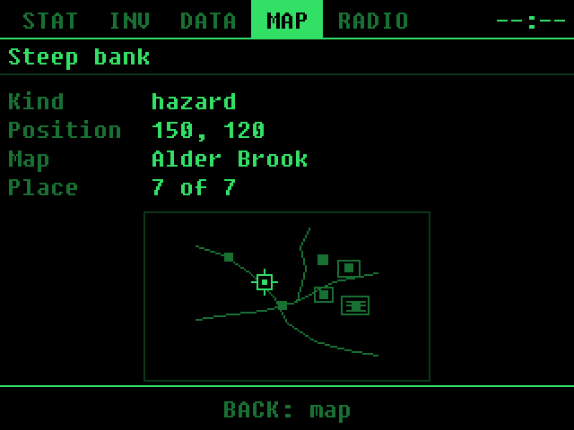

# User manual

This page is for the person who wears the device. It needs no programming knowledge.

Deitrix is the program the wrist computer runs after Pip-OS starts. It shows your status, your items, your notes, your maps and a radio on five tabs.

Deitrix has only run in the QEMU emulator so far. Nobody has tried it on a real device yet, and nobody has heard its radio: QEMU only logs the sound.

## Contents

- [What you need](#what-you-need)
- [Controls](#controls)
- [The screen](#the-screen)
- [STAT](#stat)
- [INV](#inv)
- [DATA](#data)
- [MAP](#map)
- [RADIO](#radio)
- [Holotapes](#holotapes)
- [Culvert](#culvert)
- [Saving](#saving)
- [The clock](#the-clock)
- [Your own content](#your-own-content)
- [Troubleshooting](#troubleshooting)

## What you need

- A device that runs Pip-OS. Pip-OS's [user manual](https://github.com/RobCo-Industries/Pip-OS/blob/2d10c2c207e17dc8df4e9e8f3c50d60a3dff0bf3/docs/USER_MANUAL.md) lists the boards and the parts.
- An SD card built for Deitrix. [BUILD.md](BUILD.md) explains how to build one.

At power-on Pip-OS prints its boot lines, then loads Deitrix from `/PIPBOY/ROM1.ROM` on the card. The line `LOAD ROM(1): DEITRIX 0.1.0` says Deitrix passed its checks. Deitrix then reads its content and opens the tab you used last.

## Controls

| Control | What it does |
|---|---|
| Dial turn | Changes the tab, on any view. One step is one tab. |
| LEFT, RIGHT | Move between the sub-tabs of a tab. Past the first or last sub-tab, they change the tab. Inside a nested view, LEFT goes back. |
| UP, DOWN | Move the selection, scroll a text or change a value |
| SELECT, or a push on the dial | Opens, starts, marks or confirms |
| BACK | Goes back one level from a nested view. BACK never changes the tab. |

"Back" means one level up: from a detail to its list, or from a note to the list of notes. LEFT does the same in a nested view, so a device without a BACK button still works.

The tabs wrap: the tab after RADIO is STAT, and the tab before STAT is RADIO.

Hold a button to repeat it. The first repeat comes 500 ms after the press, then one every 100 ms. Repeats move lists and change counts. They never open, close, start or store anything: those need a fresh press.

A key that does nothing on the current view plays a short low tone. Other keys play short, higher tones. The tones stay silent while the radio plays, and when UI sounds are off on the RADIO tab.

In QEMU, type the keys in the terminal that runs `make run`. The arrow keys are UP, DOWN, LEFT and RIGHT. Enter is SELECT. Backspace, or Escape alone, is BACK. The terminal has no dial key.

## The screen

The screen is 320 by 240 pixels. Pip-OS doubles it on a 640 by 480 display.

- **The tab bar** is the top row: STAT, INV, DATA, MAP and RADIO. The active tab is a filled block.
- **The clock** is at the top right, as `HH:MM` in UTC. It shows `--:--` when the device has no time. See [The clock](#the-clock).
- **The body** is the middle of the screen. Most tabs have a row of sub-tabs at its top. The active sub-tab is bright and underlined.
- **The footer** is the bottom row. It names the keys that do something on the current view, for example `UP/DOWN: item  SELECT: open`. When a view has nothing special to say, it shows `DIAL or LEFT/RIGHT: change tab`.

## STAT

STAT shows the owner of the device. It has three sub-tabs: STATUS, ATTRS and ABOUT. STAT never changes anything.

**STATUS** shows the owner's name in large letters and the owner's line under it. Under a rule it shows up to 6 gauges, each with a bar and its value, such as `82/100`. UP, DOWN and SELECT do nothing. The footer says `RIGHT: ATTRS   LEFT or DIAL: tab`.

**ATTRS** lists up to 12 attributes, with the name at the left and the value at the right. UP and DOWN move through them. Ten rows fit on the screen, so a longer list scrolls. The footer says `UP/DOWN: move   LEFT/RIGHT: page`.

**ABOUT** shows the device:

| Row | Meaning |
|---|---|
| Deitrix | The version of Deitrix |
| Pip-OS | The version of Pip-OS |
| ABI | The version of the interface between Pip-OS and Deitrix |
| SoC | The chip of the board, such as `BCM2836` |
| RAM | The memory the board gives the processor, in MiB |
| Uptime | Time since power-on, as `0d 00:00:12`. It restarts at `0d 00:00:00` after 24 days 20:31:23. |
| Time | The date and time in UTC, or `no clock` |

Under these rows ABOUT shows up to 3 lines of text from the profile. The page refreshes every second. A value Pip-OS does not give shows `unknown`.

Messages on STAT:

| Message | Meaning |
|---|---|
| `No profile on the card.` | `PROFILE.INI` is not on the card. ABOUT still works. |
| `The profile was not read.` | `PROFILE.INI` is on the card but is broken. The line under it gives the reason, such as `PROFILE.INI line 12`. |
| `No attributes in the profile.` | The profile has no attributes. |

## INV

INV lists what you carry. Each category of items has a sub-tab, such as TOOLS, FOOD, GARDN and MISC on the sample card.

**The list** shows the items of the active category. Each row shows the name and, at the right, the count and its unit, such as `20 m`. A count of 0 is dim. A marked item has a small square before its name. The row under the list gives the number of entries and their total weight, such as `4 entries, 760 g`.

| Key | What it does |
|---|---|
| UP, DOWN | Move the selection |
| LEFT, RIGHT | Change the category. Past the first or the last, they change the tab. |
| SELECT | Opens the item |

**The detail** shows the item's name, its Count, its Weight when it has one, its Category and whether it is Marked. Under them it shows the item's note.

| Key | What it does |
|---|---|
| UP, DOWN | Add or take one from the count, from 0 to 999. Hold to count fast. |
| SELECT | Marks or unmarks the item |
| BACK, LEFT | Back to the list, on the same row |
| RIGHT | Nothing |

Counts and marks are saved on the card. See [Saving](#saving). Leaving the tab closes the detail. INV remembers the category and the row.

Messages on INV:

| Message | Meaning |
|---|---|
| `No items on the card.` | `ITEMS.INI` is missing or holds no category. A second line gives the reason when the file is broken, such as `ITEMS.INI line 12`. |
| `Nothing here.` | This category has no items. |

## DATA

DATA has three sub-tabs: NOTES, TAPES and CLOCK. Leaving the tab closes an open note and the clock setter. DATA remembers the sub-tab and the selections.

### NOTES

NOTES lists the notes on the card by title, in file name order. Ten rows fit on the screen.

| Key | What it does |
|---|---|
| UP, DOWN | Move the selection |
| SELECT | Opens the note |

An open note shows its title, a rule, then its text.

| Key | What it does |
|---|---|
| UP, DOWN | Scroll the text one line |
| BACK, LEFT | Back to the list, on the same note |
| RIGHT | Nothing |

A very long note ends with `[text cut]`.

Messages on NOTES:

| Message | Meaning |
|---|---|
| `No notes on the card.` | The card has no notes, or no `NOTES` folder |
| `The notes were not read.` | The `NOTES` folder could not be read. A second line gives the reason. |
| `The note could not be read.` | This note's file could not be read |

### TAPES

TAPES lists the holotapes on the card. Each row shows the tape's title and its kind at the right: `GAME`, `UTIL` or `DATA`. The selected tape's icon shows at the top right when it has one.

| Key | What it does |
|---|---|
| UP, DOWN | Move the selection |
| SELECT | Runs the tape. See [Holotapes](#holotapes). |

Messages on TAPES:

| Message | Meaning |
|---|---|
| `No holotapes on the card.` | `/PIPBOY/HOLO/` holds no holotape |
| `The holotapes could not be read.` | Pip-OS could not list the tapes |

### CLOCK

CLOCK shows the time as `HH:MM:SS` in large digits. Under it are the date, the weekday, and `The clock runs in UTC.`. The page refreshes every second.

Without a time it shows `--:--:--` and `No clock. SELECT sets the time.`.

SELECT opens the setter. It shows `Set the time, in UTC` and the fields year, month, day, hour and minute in one row. The active field is drawn inverse, with its name under it.

| Key | What it does |
|---|---|
| UP, DOWN | Change the active field. Each field wraps at its ends. |
| RIGHT | Next field |
| LEFT | Previous field. On the year, LEFT cancels. |
| SELECT | Stores the time, with 0 seconds |
| BACK | Cancels |

The year runs from 2000 to 2099. The setter starts from the current time, or from 2026-01-01 00:00 when there is none.

Messages on CLOCK:

| Message | Meaning |
|---|---|
| `Time set.` | The time is stored. The line under it says `Lost at power-off without a clock chip.` |
| `The clock chip did not take the time.` | Pip-OS has the new time, but the clock chip did not store it. The setter stays open. |
| `The time was not set.` | Pip-OS refused the time. The setter stays open. |

## MAP

MAP has one sub-tab per map: LOCAL and WORLD. A card with one map has one sub-tab. The map's title is at the right of the sub-tab row.

The map shows its lines in dim and each place as a small square. The selected place has a ring and a cross around it. Its name and its kind are on the row under the map.

| Key | What it does |
|---|---|
| UP, DOWN | Select the previous or next place. The order wraps. |
| LEFT, RIGHT | Change the map. Past the first or the last, they change the tab. |
| SELECT | Opens the place |

The place's detail shows its name, then Kind, Position, Map and Place, such as `2 of 7`. A small copy of the whole map under them shows where the place is.

BACK or LEFT returns to the map with the same place selected. RIGHT does nothing.

Messages on MAP:

| Message | Meaning |
|---|---|
| `No map on the card.` | No map could be shown. The line under it gives the reason: `MAP.INI missing`, `MAP.INI holds no map.` or the broken line, such as `MAP.INI line 4`. |
| `No places on this map.` | The map has no places |

## RADIO

RADIO plays music. It lists the stations, says what plays, and holds two settings.

- **The stations.** One row per station. The one that plays shows `ON AIR`. A dim station has a missing or broken file.
- **Now playing.** `Playing` and the station's name, then `tune` or `recording`. When nothing plays it says `Radio off.`.
- **The settings.** `Volume` with a bar and the level from 0 to 100. `UI sounds` with `On` or `Off`.

UP and DOWN move one cursor through the stations, then Volume, then UI sounds.

| Row | Key | What it does |
|---|---|---|
| A station | SELECT | Starts it. On the station that plays, stops it. |
| A station | LEFT, RIGHT | Change the tab |
| Volume | LEFT, RIGHT | Volume down or up to the next step of 10. Hold to repeat. |
| UI sounds | SELECT, LEFT, RIGHT | Turns the key tones on or off |

The radio keeps playing on the other tabs. It does not start by itself at power-on: the cursor starts on the last station you played. Running a holotape stops it.

Messages on RADIO:

| Message | Meaning |
|---|---|
| `No stations on the card.` | `RADIO.INI` is missing or broken. The line under it gives the reason, such as `RADIO.INI missing`. The settings still work. |
| `Station has nothing to play.` | The station could not start or stopped on an error. The line under it gives the reason, such as `LULLABY.TUN missing`, or `<file> did not play`. |

## Holotapes

A holotape is a program on the card, in `/PIPBOY/HOLO/`, with the extension `.HTP`. It is a game, a utility or data. Deitrix runs games and utilities from DATA, TAPES. A tape takes the whole screen while it runs. When it ends, Deitrix comes back on TAPES.

To run a tape, select it in TAPES and press SELECT. Deitrix then:

1. Writes every change that is not on the card yet. A tape that crashes the device loses nothing.
2. Stops the radio. It stays off after the tape.
3. Runs the tape.

When the write fails, the tape does not start. The line under the list says `Save failed. SELECT again runs it.`. The radio keeps playing. Press SELECT again to run the tape anyway: your recent changes are then not on the card. Moving the selection or leaving TAPES cancels the second chance.

After a tape, one line under the list says how it ended:

| Line | Meaning |
|---|---|
| `Tape ended, status N.` | The tape ended by itself. N is the number it returned. Its meaning depends on the tape. |
| `Tape was stopped by the system.` | The tape crashed and Pip-OS stopped it |
| `Data tapes cannot be started.` | The tape holds data only |
| `Not a holotape.` | The file failed Pip-OS's checks |
| `Card error.` | The card failed while Pip-OS read the tape |
| `Tape not found.` | The file is no longer on the card |
| `The tape could not start.` | Any other error |

The line goes away when you move the selection or leave TAPES.

## Culvert

Culvert is a pipe-turning puzzle. It comes on the card as the holotape `CULVERT.HTP`. Run it from DATA, TAPES. You turn pipe tiles until water from the source reaches every tile. The title screen offers `New game` and `Quit`, and `Continue (level N)` once you have solved a level. BACK opens the pause menu. Quit returns to Deitrix with `Tape ended, status 0.`.

[CULVERT.md](CULVERT.md) has the rules, the keys and what the game saves.

## Saving

Deitrix saves two files in `/PIPBOY/SAVE/` on the card:

| File | What it holds |
|---|---|
| `DEITRIX.SAV` | The last tab, the volume, UI sounds on or off, and the last station |
| `INV.SAV` | The count and the mark of every item |

You never save by hand. Deitrix writes a file 2 seconds after the last change, and at most 10 seconds after the first one. It writes only when a value changed. Before a holotape runs, it writes at once.

When the card cannot be written, Deitrix tries again 5 seconds later, up to 3 times. Then it stops trying until the next change. Your changes stay on screen but are not on the card, and they are lost at power-off. No message shows this, except `Save failed. SELECT again runs it.` on TAPES.

To start over, delete `DEITRIX.SAV` and `INV.SAV` from the card's `/PIPBOY/SAVE/` folder on a computer. Leave files whose names start with `~` or `#` in place: Pip-OS uses them to finish an interrupted save.

## The clock

The clock runs in UTC. Pip-OS has no time zones.

- **With a clock chip** that holds a valid time, Pip-OS starts the clock from it at power-on. A time you set on DATA, CLOCK is written to the chip too, so it survives power-off.
- **Without a clock chip**, the device has no time at power-on. The header shows `--:--` and CLOCK shows `--:--:--`. Set the time on DATA, CLOCK. It runs until power-off and is lost then.

The clock chip holds years 2000 to 2099. The setter allows the same years.

## Your own content

Everything Deitrix shows comes from text files in `/PIPBOY/DATA/` on the card. Every file is optional. [CONTENT.md](CONTENT.md) gives the formats and every limit.

| File | Tab |
|---|---|
| `PROFILE.INI` | STAT |
| `ITEMS.INI` | INV |
| `NOTES/*.TXT` | DATA, NOTES |
| `MAP.INI` | MAP |
| `RADIO.INI`, `RADIO/*.TUN`, `RADIO/*.PCM` | RADIO |

A short path:

1. Start from the sample files in `content/PIPBOY/DATA/` of the repository.
2. Edit them in a text editor. Keep `version = 1` at the top of each INI file. Keep each item's id when you change the item, so your saved counts stay.
3. Write a note as `NOTES/<NAME>.TXT`, with the title on the first line. Use upper-case 8.3 names for every file.
4. For music, write a `.TUN` tune and add a station to `RADIO.INI`. `python3 tools/tun2notes.py MY.TUN --wav my.wav` lets you hear it on a computer. For a recording, convert it to raw 8-bit unsigned mono at 8000 Hz. [CONTENT.md](CONTENT.md#making-your-own-content) gives a `sox` command.
5. Check the files: put them at `<dir>/PIPBOY/DATA/` and run `python3 tools/check_content.py <dir>`. It prints one line per problem and nothing when all is well.
6. Build the card again with `make sdimage` or `make bootdir`, or copy the files to the card's `/PIPBOY/DATA/`.

## Troubleshooting

| Symptom | Cause | What to do |
|---|---|---|
| `ROM(1) NOT LOADED: ...` at boot | Pip-OS could not load Deitrix | See the table in Pip-OS's [user manual](https://github.com/RobCo-Industries/Pip-OS/blob/2d10c2c207e17dc8df4e9e8f3c50d60a3dff0bf3/docs/USER_MANUAL.md#what-you-see-at-boot) |
| `--:--` in the header | The device has no time | Set it on DATA, CLOCK. Fit a clock chip to keep it. |
| The time is lost after power-off | No clock chip | Fit a clock chip, then set the time again |
| `The clock chip did not take the time.` | The chip did not store the time | The time runs until power-off. Check the chip. |
| `No profile on the card.` | `PROFILE.INI` is missing | Add it to `/PIPBOY/DATA/` |
| `The profile was not read.`, `PROFILE.INI line 12` | A broken line in the file | Fix that line. Run `tools/check_content.py`. |
| `No items on the card.` | `ITEMS.INI` is missing, broken or has no category | Read the line under it. Run `tools/check_content.py`. |
| Counts are back to the file's values | `INV.SAV` was deleted or damaged, or the item's id changed | Keep item ids the same when you edit `ITEMS.INI` |
| `No notes on the card.` | No `.TXT` files in `/PIPBOY/DATA/NOTES/` | Add notes there with 8.3 names |
| `The notes were not read.` or `The note could not be read.` | The folder or the file could not be read | Read the reason on the second line. Check the card on a computer. |
| `No holotapes on the card.` | No `.HTP` file in `/PIPBOY/HOLO/` | Put the tapes there with 8.3 names |
| `Save failed. SELECT again runs it.` | The card cannot be written | Check that the card is in place and not full or locked. SELECT again runs the tape without the save. |
| `Tape was stopped by the system.` | The tape crashed | Report it to the tape's author |
| `Not a holotape.` | The file is damaged or not a holotape | Copy the tape again |
| `No map on the card.` | `MAP.INI` is missing, broken or holds no valid map | Read the line under it. Run `tools/check_content.py`. |
| `No stations on the card.` | `RADIO.INI` is missing or broken | Read the line under it. Run `tools/check_content.py`. |
| A dim station, or `Station has nothing to play.` | The station's file is missing or broken | Put the file named on the second line in `/PIPBOY/DATA/RADIO/` |
| No key tones | The radio plays, or UI sounds are off | Stop the radio, or turn UI sounds on, on RADIO |
| No sound at all | The volume is at 0 | Raise it on RADIO |
| BACK does nothing | You are on a top-level view: BACK never changes the tab | Use the dial, LEFT or RIGHT |
| Changes are lost after power-off | The card could not be written | Check the card. Wait a few seconds after a change before power-off. |
