# User manual

This page is for the person who wears the device. It needs no programming knowledge.

Deitrix is the program the wrist computer runs after Pip-OS starts. It shows your status, your items, your notes, your maps and a radio on five tabs. It also runs holotapes, such as the game Culvert.

Deitrix has run on one real board: a Pi Zero W 1.1, on 2026-11-24. There it booted, read its data files, took keys sent over serial and saved its settings on the card. At the next power-on it loaded those settings, reached all five tabs and ran Culvert from TAPES until Quit. The buttons, the dial, the screen and the speaker are still untested on any device, and nobody has heard the radio. QEMU only logs the sound.

The pictures on this page are the test screenshots of one emulated board. The tests compare each screen with them pixel for pixel. They are doubled to 640 by 480, as Pip-OS shows them.

## Contents

- [What you need](#what-you-need)
- [Turning it on](#turning-it-on)
- [The screen](#the-screen)
- [Controls](#controls)
- [STAT](#stat)
- [INV](#inv)
- [DATA](#data)
- [Playing Culvert](#playing-culvert)
- [MAP](#map)
- [RADIO](#radio)
- [Saving](#saving)
- [The clock](#the-clock)
- [Your own content](#your-own-content)
- [Troubleshooting](#troubleshooting)

## What you need

- A device that runs Pip-OS. Pip-OS's [user manual](https://github.com/RobCo-Industries/Pip-OS/blob/693e4578c8f73329032a5a59e41e3ba4a311dddd/docs/USER_MANUAL.md) lists the boards and the parts.
- An SD card built for Deitrix. [BUILD.md](BUILD.md) explains how to build one.

## Turning it on

Pip-OS starts first and prints its boot lines. Among them, `1 HOLOTAPE FOUND` counts the holotapes on the card, and `LOAD ROM(1): DEITRIX 0.1.0` says Deitrix passed Pip-OS's checks. Pip-OS's manual explains [every boot line](https://github.com/RobCo-Industries/Pip-OS/blob/693e4578c8f73329032a5a59e41e3ba4a311dddd/docs/USER_MANUAL.md#what-you-see-at-boot).

Deitrix then reads its content and its saves from the card and opens the tab you used last. The first time, that is STAT. The radio does not start by itself.

## The screen

The screen is 320 by 240 pixels. Pip-OS doubles it on a 640 by 480 display.

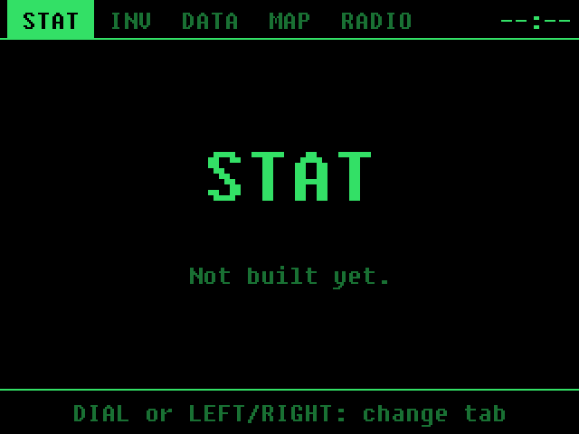

| Part | Where | What it shows |
|---|---|---|
| Tab bar | Top row | STAT, INV, DATA, MAP and RADIO. The active tab is a filled block. |
| Unsaved mark | Top row, left of the clock | A `!` while your changes have not reached the card. See [The unsaved mark](#the-unsaved-mark). |
| Clock | Top right | The time as `HH:MM` in UTC, or `--:--` when the device has no time. See [The clock](#the-clock). |
| Sub-tabs | Under the tab bar | The pages of the tab. The active one is bright and underlined. RADIO has none. |
| Body | Middle | The page. A status row at the bottom of the body shows a summary or a result on some pages. |
| Footer | Bottom row | The keys that do something on this view, such as `UP/DOWN: move  SELECT: open`. For 3 seconds after a tape slot change, a notice instead. See [The tape slot](#the-tape-slot). |

The footer names keys as `UP/DOWN`, `LEFT/RIGHT`, `SELECT`, `BACK` and `DIAL`. It never names the tab change, since the dial always changes the tab. A view with no key of its own shows `DIAL: change tab`. A view whose only keys move between sub-tabs shows `LEFT/RIGHT: page`.

### The unsaved mark

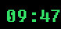

The picture above shows the clock area. When a change has waited 12 seconds without reaching the card, a `!` appears just left of the clock. It does not blink. A card that works never shows it, because a save takes at most 10 seconds.

The `!` goes away as soon as every change is on the card. If it stays:

1. Check that the card is in place, not full and not locked.
2. Make any change, or start a holotape. Both make Deitrix try to write again.
3. Do not power off while it shows. Changes not on the card are lost at power-off.

## Controls

The device has a dial and six buttons: UP, DOWN, LEFT, RIGHT, SELECT and BACK. None of them has been tried on real hardware yet. On one Pi Zero W, keys sent over serial worked. LEFT reached all five tabs. Between them, LEFT, RIGHT, DOWN, SELECT and BACK worked in STAT, INV, RADIO, TAPES and Culvert. UP was not sent there.

| Control | What it does |
|---|---|
| Dial turn | Changes the tab, on any view. One step is one tab. The tabs wrap: after RADIO comes STAT. |
| Dial push | The same as SELECT |
| UP, DOWN | Move the selection, scroll a text or change a value |
| LEFT, RIGHT | Move between the sub-tabs. Past the first or the last sub-tab, they change the tab. Inside a nested view, LEFT goes back. |
| SELECT | Opens, starts, marks or confirms |
| BACK | Goes back one level from a nested view. BACK never changes the tab. |

A nested view is a page you open from a list: an item's detail, an open note, a place's detail, the clock setter. LEFT goes back from it like BACK, so a device without a BACK button still works. RIGHT does nothing there.

### Holding a key

Hold a button to repeat it. The first repeat comes 500 ms after the press, then one every 100 ms. Repeats move lists, scroll text and change values, such as a count or the volume.

When a press opens a view, closes one or changes the tab, holding that key does nothing more. Let go and press again to act once more. So a held LEFT that closes an item's detail stays on the list, and a held SELECT that runs a tape runs it once.

### Key tones

With `system_sound = yes` in `PIPOS.CFG`, a short rising chirp plays when the first screen appears. It stays silent when UI sounds are off or the radio plays, and with the system sound off, the default.

A key that does something plays a short tone. A key that does nothing on the view plays a short low tone. Repeats never play the low tone. The tones stay silent while the radio plays, and when UI sounds are off on RADIO.

With UI sounds on `Full`, a list row move and a select each play a sound of their own in place of their tones. The other keys keep their tones. A count change, a volume step, a text scroll and a new map place are not row moves: they keep the move tone. `Full` needs `system_sound = yes` in `PIPOS.CFG`. Without it RADIO offers only `On` and `Off`, and a saved `Full` shows `On` and plays the tones.

### In QEMU

Type the keys in the terminal that runs `make run`. The arrow keys are UP, DOWN, LEFT and RIGHT. Enter is SELECT. Backspace, or Escape alone, is BACK. The terminal has no dial key, so LEFT and RIGHT change the tab.

## STAT

STAT shows the owner of the device and the device itself. It has three sub-tabs: STATUS, ATTRS and ABOUT. Nothing on STAT changes your data.

**STATUS** shows the owner's name in large letters and the owner's line under it. Under a rule it shows up to 6 gauges, each with a bar and its value, such as `82/100`. See the picture in [The screen](#the-screen).

**ATTRS** lists up to 12 attributes, the name at the left and the value at the right. Ten rows fit, so a longer list scrolls.

**ABOUT** shows the device, refreshed each second:

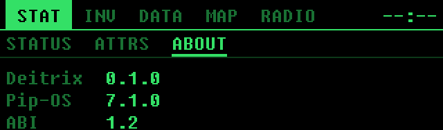

| Row | Meaning |
|---|---|
| Deitrix | The version of Deitrix |
| Pip-OS | The version of Pip-OS |
| ABI | The version of the interface between Pip-OS and Deitrix |
| SoC | The chip of the board, such as `BCM2836` |
| RAM | The memory the board gives the processor, in MiB |
| Uptime | Time since power-on, as days then hours, minutes and seconds, such as `0d 00:00:12` |
| Time | The date and time in UTC, or `no clock` |

Under these rows ABOUT shows up to 3 lines of text from the profile. A value Pip-OS does not give shows `unknown`.

| Sub-tab | Key | What it does |
|---|---|---|
| ATTRS, with 2 or more attributes | UP, DOWN | Move through the list |
| Any | LEFT, RIGHT | Change the sub-tab. Left of STATUS or right of ABOUT, change the tab. |

Other keys play the low tone.

| Message | Meaning |
|---|---|
| `No profile on the card.` | `PROFILE.INI` is not on the card. ABOUT still works. |
| `The profile was not read.` | `PROFILE.INI` is broken. The line under it gives the reason, such as `PROFILE.INI line 12`. |
| `No attributes in the profile.` | The profile has no attributes |

## INV

INV lists what you carry. Each category has a sub-tab, such as TOOLS, FOOD, GARDN and MISC on the sample card.

**The list** shows the items of the category. Each row shows the name and, at the right, the count and its unit, such as `20 m`. A count of 0 is dim. A marked item has a small square before its name. The row at the bottom gives the number of entries and their total weight, such as `4 entries, 760 g`.

| Key | What it does |
|---|---|
| UP, DOWN | Move the selection |
| LEFT, RIGHT | Change the category. Past the first or the last, they change the tab. |
| SELECT | Opens the item |

**The detail** shows the item's name, its Count, its Weight when it has one, its Category and whether it is Marked. Under them it shows the item's note.

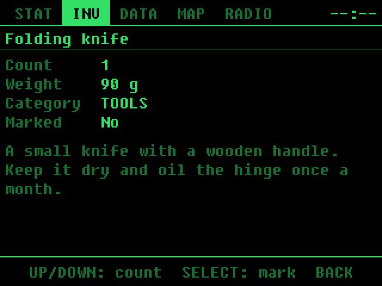

| Key | What it does |
|---|---|
| UP, DOWN | Add or take one from the count, from 0 to 999. Hold to count fast. |
| SELECT | Marks or unmarks the item |
| BACK, LEFT | Back to the list, on the same row |

Counts and marks are saved on the card. See [Saving](#saving). Leaving the tab closes the detail. INV remembers the category and the row until power-off.

| Message | Meaning |
|---|---|
| `No items on the card.` | `ITEMS.INI` is missing or holds no category. A second line gives the reason when the file is broken, such as `ITEMS.INI line 12`. |
| `Nothing here.` | This category has no items |

## DATA

DATA has three sub-tabs: NOTES, TAPES and CLOCK. Leaving the tab closes an open note and the clock setter, and clears the result lines. DATA remembers the sub-tab and the selections.

### NOTES

NOTES lists the notes on the card by title, in file name order. Ten rows fit.

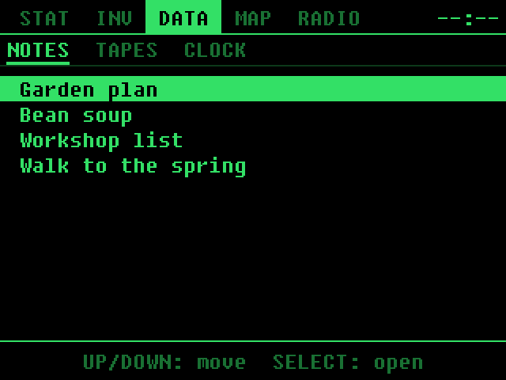

| Key | What it does |
|---|---|
| UP, DOWN | Move the selection |
| SELECT | Opens the note |

An open note shows its title, a rule, then its text. A very long note ends with `[text cut]`.

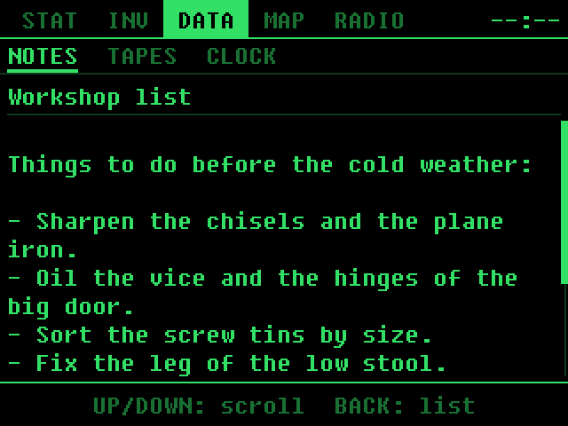

| Key | What it does |
|---|---|
| UP, DOWN | Scroll the text one line, when it is longer than the screen |
| BACK, LEFT | Back to the list, on the same note |

| Message | Meaning |
|---|---|
| `No notes on the card.` | The card has no notes, or no `NOTES` folder |
| `The notes were not read.` | The `NOTES` folder could not be read. A second line gives the reason. |
| `The note could not be read.` | This note's file could not be read |

### TAPES

A holotape is a program on the card, in `/PIPBOY/HOLO/`, with the extension `.HTP`. TAPES lists them. Each row shows the tape's title and its kind at the right: `GAME`, `UTIL` or `DATA`. The selected tape's icon shows at the top right when it has one. The default card holds one tape, Culvert.

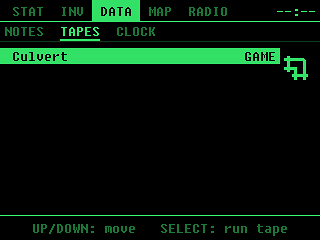

| Key | What it does |
|---|---|
| UP, DOWN | Move the selection |
| SELECT | Runs the tape |

A tape takes the whole screen while it runs. When it ends, Deitrix comes back on TAPES.

When you press SELECT, Deitrix does this:

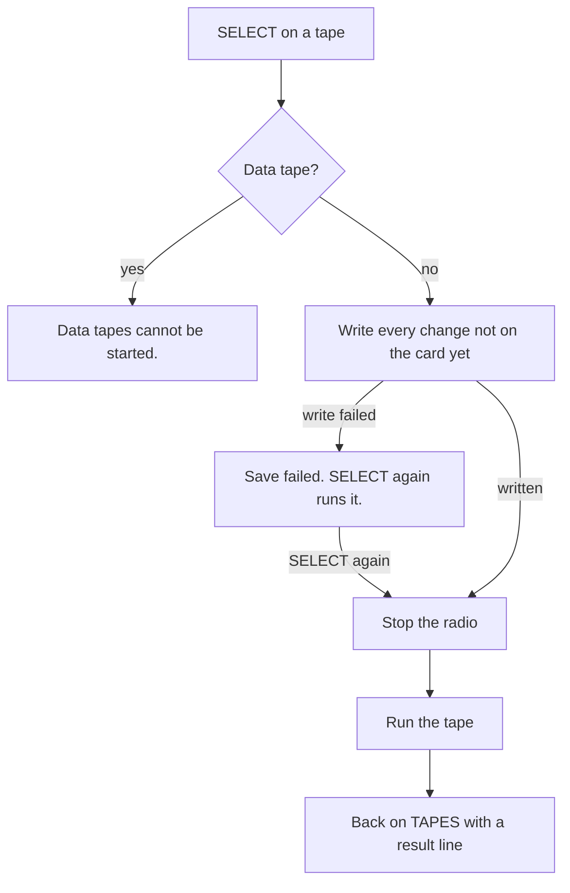

Deitrix writes your changes first, so a tape that crashes the device loses nothing. The radio stays off after the tape.

When the write fails, the tape does not start, and the radio keeps playing. The line under the list says `Save failed. SELECT again runs it.`. Press SELECT again to run the tape anyway: your recent changes are then not on the card. Moving the selection or leaving TAPES cancels this second chance.

After a tape, one line under the list says how it ended:

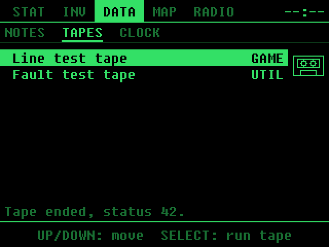

| Line | Meaning |
|---|---|
| `Tape ended, status N.` | The tape ended by itself. N is the number it returned, and the tape decides what it means. Culvert always returns 0. |
| `Tape was stopped by the system.` | The tape crashed and Pip-OS stopped it |
| `Data tapes cannot be started.` | The tape holds data only |
| `Not a holotape.` | The file failed Pip-OS's checks |
| `Card error.` | The card failed while Pip-OS read the tape |
| `Tape not found.` | The file is no longer on the card |
| `Tape pulled while running.` | You pulled the slot card while its tape ran. Pip-OS stopped the tape. |
| `The tape could not start.` | Any other error |

The line goes away when you move the selection or leave TAPES.

| Message | Meaning |
|---|---|
| `No holotapes on the card.` | `/PIPBOY/HOLO/` holds no holotape |
| `The holotapes could not be read.` | Pip-OS could not list the tapes |

#### The tape slot

Some Pip-Boys have a holotape slot: a second card that goes in and out while Deitrix runs. Pip-OS turns it on with `[holotape] slot = on` in `PIPOS.CFG`. Deitrix uses it only when Pip-OS reports a slot. With no slot, or on a Pip-OS older than ABI 1.4, nothing on the screen mentions one.

Put tapes in the root folder of the slot card, as `NAME.HTP`. Slot tapes come first in TAPES, and their kind reads `SLOT GAME` or `SLOT UTIL`. When a slot tape has the same file name as a tape on the boot card, TAPES shows only the slot tape. Pull the card and the boot card's tape comes back.

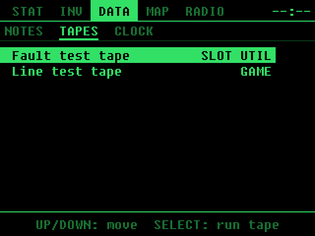

The list follows the slot while you look at it. You stay on TAPES, and the selection stays on the same tape. When the selected tape leaves, the selection stays on the same row.

Each change shows a notice in the footer for 3 seconds, on any tab. The keys keep working while it shows.

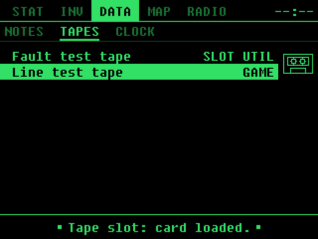

| Notice | Meaning |
|---|---|
| `Tape slot: card loaded.` | A card went in and its tapes are listed |
| `Tape slot: card removed.` | The card came out |
| `Tape slot: card unreadable.` | The card cannot be used. Its tapes are not listed until you pull it. |

A card can take a moment to load. Until the notice shows, its tapes are not in the list.

If you pull the card while one of its tapes runs, Pip-OS stops the tape. Deitrix comes back on TAPES with `Tape pulled while running.`, and the tape is gone from the list.

Nobody has tried a slot on real hardware yet. The tests use a slot that Pip-OS fakes in memory.

### CLOCK

CLOCK shows the time as `HH:MM:SS` in large digits, then the date, the weekday and `The clock runs in UTC.`. It refreshes each second.

Without a time it shows `--:--:--` and `No clock. SELECT sets the time.`.

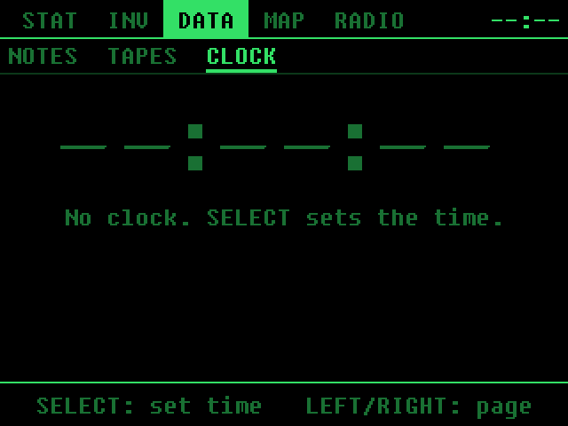

SELECT opens the setter. It shows `Set the time, in UTC` and the fields year, month, day, hour and minute in one row. The active field is inverse, with its name under it.

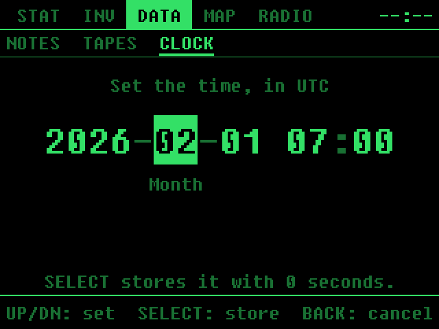

| Key | What it does |
|---|---|
| UP, DOWN | Change the active field. Each field wraps at its ends. Hold to change fast. |
| RIGHT | Next field |
| LEFT | Previous field. On the year, LEFT cancels. |
| SELECT | Stores the time, with 0 seconds |
| BACK | Cancels |

The year runs from 2000 to 2099. The setter starts from the current time, or from 2026-01-01 00:00 when there is none.

| Message | Meaning |
|---|---|
| `Time set.` | The time is stored. The line under it says `Lost at power-off without a clock chip.` |
| `The clock chip did not take the time.` | The clock runs with the new time, but the clock chip did not store it. The setter stays open. |
| `The time was not set.` | Pip-OS refused the time. The setter stays open. |

## Playing Culvert

Culvert is a pipe-turning puzzle on the holotape `CULVERT.HTP`. Start it from DATA, TAPES. [CULVERT.md](CULVERT.md) has the full rules.

### The goal

The grid holds square tiles, each with a pipe piece: an end cap, a straight, an elbow, a tee or a cross. The tile with the ring is the source. Water flows from it through pipes that meet. Pipes with water are bright, the others dim.

You solve a level when every tile has water and no pipe opens into a wall or into a side with no pipe.

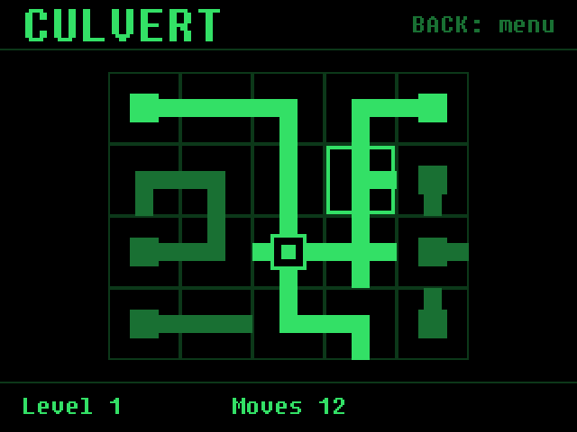

### The title screen

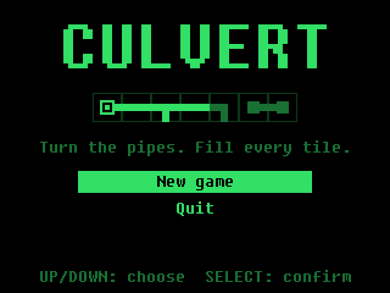

The title offers `New game` and `Quit`. Once you have solved a level, it also offers `Continue (level N)` at the top, where N is the first level you have not solved.

| Key | What it does |
|---|---|
| UP, DOWN, or the dial | Move the bar. It stops at the first and the last entry. |
| SELECT, or a dial push | Chooses |
| BACK | Quits to Deitrix |

### Playing

The status row at the bottom shows the level, the moves and the time as `m:ss`.

| Key | What it does |
|---|---|
| UP, DOWN, LEFT, RIGHT | Move the cursor. It stops at the edges. Hold to repeat. |
| SELECT, or a dial push | Turns the tile a quarter turn clockwise. Holding it turns once. |
| Dial turn | Turns the tile one quarter per step, in the dial's direction |
| BACK | Opens the pause menu |

Each quarter turn counts as one move. Four quarters bring a tile back, so a fast spin of the dial turns only the steps left over after whole turns. A spin of 5 steps turns one quarter.

Culvert needs BACK to pause or quit. On the device that is the BACK button. In QEMU it is Backspace.

### Levels

The level number alone sets the puzzle, so a level is the same on every device. The grid starts at 5 by 4 tiles and grows every three levels, up to 10 by 7 from level 25 on. There is no last level.

When you solve a level, the pipes flash and a short tune plays. Then the screen says `Level N done in M moves`. SELECT or a dial push starts the next level. BACK opens the pause menu.

### The pause menu

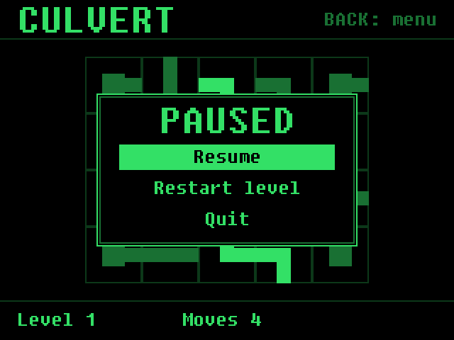

The time stops while the menu is open.

| Entry | What it does |
|---|---|
| Resume | Back to the level. BACK does the same. |
| Restart level | The same level from the start, with no moves and the time at 0:00 |
| Quit | Leaves the game. Deitrix shows TAPES with `Tape ended, status 0.` |

### How Culvert saves

Culvert writes its save, `CULVERT.SAV` in `/PIPBOY/SAVE/`, each time you solve a level. It keeps the highest level you reached and, for each grid size, your fewest moves. A level you quit before solving is not saved. A missing or damaged save starts fresh, with no message.

### Sound

A turn plays a short tick. A turn that brings water to new tiles plays two rising notes. A solved level plays a short tune. You can play without sound.

## MAP

MAP has one sub-tab per map: LOCAL and WORLD. A card with one map has one sub-tab. The map's title is at the right of the sub-tab row.

The map shows its lines in dim and each place as a small square. The selected place has a ring and a cross around it. Its name and its kind are on the row under the map.

| Key | What it does |
|---|---|
| UP, DOWN | Select the previous or next place, when the map has two or more. The order wraps. |
| LEFT, RIGHT | Change the map. Past the first or the last, they change the tab. |
| SELECT | Opens the place |

The place's detail shows its name, then Kind, Position, Map and Place, such as `2 of 7`. A small copy of the whole map under them shows where the place is.

BACK or LEFT returns to the map with the same place selected.

| Message | Meaning |
|---|---|
| `No map on the card.` | No map could be shown. The line under it gives the reason: `MAP.INI missing`, `MAP.INI holds no map.` or the broken line, such as `MAP.INI line 4`. |
| `No places on this map.` | The map has no places |

## RADIO

RADIO plays music. It lists the stations, says what plays and holds two settings. It has no sub-tabs.

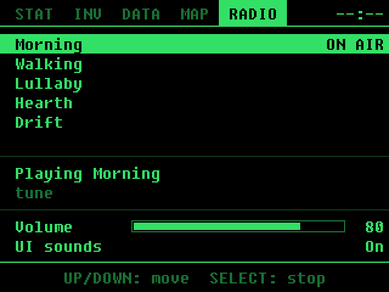

| Part | What it shows |
|---|---|
| Stations | One row per station. The one that plays shows `ON AIR`. A dim station has a missing or broken file. |
| Now playing | `Playing` and the station's name, then `tune` or `recording`. When nothing plays, `Radio off.`. |
| Settings | `Volume` with a bar and the level from 0 to 100, and `UI sounds` with `Off`, `On` or `Full` |

UP and DOWN move one cursor through the stations, then Volume, then UI sounds. The selected row is inverse, the Volume bar too.

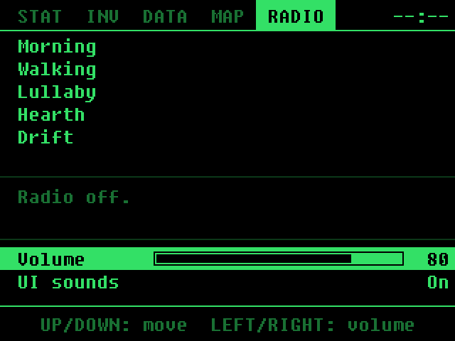

| Row | Key | What it does |
|---|---|---|
| A station | SELECT | Starts it. On the station that plays, stops it. |
| A station | LEFT, RIGHT | Change the tab |
| Volume | LEFT, RIGHT | Volume down or up to the next step of 10. Hold to repeat. At 0 or 100 the low tone plays. |
| UI sounds | SELECT, LEFT, RIGHT | Steps through `Off`, `On` and `Full`. `Full` shows only with the system sound on. |

The radio keeps playing on the other tabs. At power-on it does not start: the cursor waits on the last station you played. Running a holotape stops it. The volume and UI sounds are saved on the card.

| Message | Meaning |
|---|---|
| `No stations on the card.` | `RADIO.INI` is missing or broken. The line under it gives the reason, such as `RADIO.INI missing`. The settings still work. |
| `Station has nothing to play.` | The station could not start or stopped on an error. The line under it gives the reason, such as `LULLABY.TUN missing`. |

## Saving

Deitrix saves two files in `/PIPBOY/SAVE/` on the card:

| File | What it holds |
|---|---|
| `DEITRIX.SAV` | The last tab, the volume, UI sounds off, on or full, and the last station |
| `INV.SAV` | The count and the mark of every item |

You never save by hand. Deitrix writes a file 2 seconds after the last change, and at most 10 seconds after the first one. It writes only when a value changed. Before a holotape runs, it writes at once.

When the card cannot be written, Deitrix tries again 5 seconds later, up to 3 times, then waits for the next change. Your changes stay on screen but are not on the card, and the header shows the [unsaved mark](#the-unsaved-mark). They are lost at power-off. On TAPES, starting a tape then shows `Save failed. SELECT again runs it.`.

Pip-OS writes each save through two work files with the same name, one that starts with `~` and one that starts with `#`, such as `~INV.SAV` and `#INV.SAV`. After an interrupted save, it uses them to finish the save or bring back the old one. In normal use, leave these files in place.

To reset a save, turn the device off and put the card in a computer. Copy the `/PIPBOY/SAVE/` folder somewhere first if you may want it back. Then delete the save and its work files. If you delete only the `.SAV` file, Pip-OS can rebuild it from a work file.

- To start over, delete `DEITRIX.SAV`, `INV.SAV`, and any `~DEITRIX.SAV`, `#DEITRIX.SAV`, `~INV.SAV` or `#INV.SAV`.
- To start Culvert over, delete `CULVERT.SAV`, and any `~CULVERT.SAV` or `#CULVERT.SAV`.

## The clock

The clock runs in UTC. Pip-OS has no time zones.

- **With a clock chip** that holds a valid time, Pip-OS starts the clock from it at power-on. A time you set on DATA, CLOCK goes to the chip too, so it survives power-off.
- **Without a clock chip**, the device has no time at power-on. The header shows `--:--` and CLOCK shows `--:--:--`. Set the time on DATA, CLOCK. It runs until power-off.

The clock chip holds years 2000 to 2099, and the setter allows the same years. The tests use an emulated clock chip. No real chip has been tried with Deitrix yet.

## Your own content

Everything Deitrix shows comes from text files in `/PIPBOY/DATA/` on the card. Every file is optional. [CONTENT.md](CONTENT.md) gives the formats and every limit.

| File | Tab |
|---|---|
| `PROFILE.INI` | STAT |
| `ITEMS.INI` | INV |
| `NOTES/*.TXT` | DATA, NOTES |
| `MAP.INI` | MAP |
| `RADIO.INI`, `RADIO/*.TUN`, `RADIO/*.PCM` | RADIO |

1. Start from the sample files in `content/PIPBOY/DATA/` of the repository.
2. Edit them in a text editor. Keep `version = 1` at the top of each INI file. Keep each item's id when you change the item, so your saved counts stay.
3. Write a note as `NOTES/<NAME>.TXT`, with the title on the first line. Use upper-case 8.3 names for every file.
4. For music, write a `.TUN` tune and add a station to `RADIO.INI`. `python3 tools/tun2notes.py MY.TUN --wav my.wav` lets you hear it on a computer. For a recording, convert it to raw 8-bit unsigned mono at 8000 Hz. [CONTENT.md](CONTENT.md#making-your-own-content) gives a `sox` command.
5. Check the files: put them at `<dir>/PIPBOY/DATA/` and run `python3 tools/check_content.py <dir>`. It prints one line per problem and nothing when all is well.
6. Build the card again with `make sdimage` or `make bootdir`, or copy the files to the card's `/PIPBOY/DATA/`.

## Troubleshooting

| Symptom | Cause | What to do |
|---|---|---|
| `ROM(1) NOT LOADED: ...` at boot | Pip-OS could not load Deitrix | See Pip-OS's [boot table](https://github.com/RobCo-Industries/Pip-OS/blob/693e4578c8f73329032a5a59e41e3ba4a311dddd/docs/USER_MANUAL.md#what-you-see-at-boot) |
| `!` left of the clock stays | Changes cannot reach the card | Check that the card is in place, not full and not locked. Make a change to try again. Do not power off. |
| Changes are lost after power-off | The card could not be written, or power went off within 10 seconds of a change | Check the card. Wait until no `!` shows and 10 seconds have passed. |
| `--:--` in the header | The device has no time | Set it on DATA, CLOCK. Fit a clock chip to keep it. |
| The time is lost after power-off | No clock chip | Fit a clock chip, then set the time again |
| `The clock chip did not take the time.` | The chip did not store the time | The time runs until power-off. Check the chip. |
| `No profile on the card.` | `PROFILE.INI` is missing | Add it to `/PIPBOY/DATA/` |
| `The profile was not read.`, `PROFILE.INI line 12` | A broken line in the file | Fix that line. Run `tools/check_content.py`. |
| `No items on the card.` | `ITEMS.INI` is missing, broken or has no category | Read the line under it. Run `tools/check_content.py`. |
| Counts are back to the file's values | `INV.SAV` was deleted or damaged, or the item's id changed | Keep item ids the same when you edit `ITEMS.INI` |
| `No notes on the card.` | No `.TXT` files in `/PIPBOY/DATA/NOTES/` | Add notes there with 8.3 names |
| `The notes were not read.` or `The note could not be read.` | The folder or the file could not be read | Read the reason on the second line. Check the card on a computer. |
| `No holotapes on the card.` | No `.HTP` file in `/PIPBOY/HOLO/` | Put the tapes there with 8.3 names. `make bootdir` puts Culvert there. |
| `Save failed. SELECT again runs it.` | The card cannot be written | Check the card. SELECT again runs the tape without the save. |
| `Tape was stopped by the system.` | The tape crashed | Report it to the tape's author |
| `Not a holotape.` | The file is damaged or not a holotape | Copy the tape again |
| `Data tapes cannot be started.` | The tape holds data only | Nothing to do: it is not a program |
| Culvert starts at level 1 again | Its save `CULVERT.SAV` was missing or damaged | Nothing to fix. The next solved level writes a new save. |
| `No map on the card.` | `MAP.INI` is missing, broken or holds no valid map | Read the line under it. Run `tools/check_content.py`. |
| `No stations on the card.` | `RADIO.INI` is missing or broken | Read the line under it. Run `tools/check_content.py`. |
| A dim station, or `Station has nothing to play.` | The station's file is missing or broken | Put the file named on the second line in `/PIPBOY/DATA/RADIO/` |
| No key tones | The radio plays, or UI sounds are off | Stop the radio, or turn UI sounds on, on RADIO |
| No sound at all | The volume is at 0 | Raise it on RADIO |
| BACK does nothing | You are on a top-level view, and BACK never changes the tab | Use the dial, LEFT or RIGHT |
| A held key stops acting | It opened or closed a view, or changed the tab | Let go and press again |
